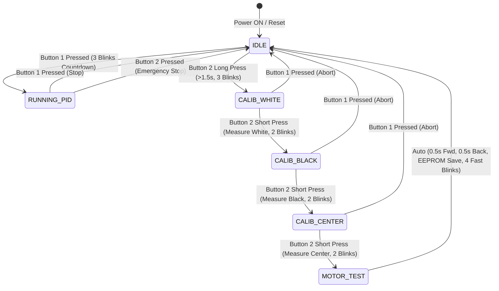

# Arduino Nano PID Line Follower Robot (LFR) - Architecture & Technical Reference

This document serves as the master architectural reference, pinout map, function directory, state machine specification, EEPROM memory layout, and maintenance log for the high-performance Arduino Nano PID Line Follower Robot.

---

## 1. Hardware Pinout & Wiring Map

The microcontroller is an **Arduino Nano (ATmega328P, 16 MHz, 5V logic)**. The motor driver is a **TB6612FNG Dual H-Bridge**, and the reflectance sensor array consists of **8 analog TCRT5000 / RSL 08 phototransistors** wired directly without a multiplexer.

### Master Pin Assignment Table (Matching `connections.txt`)

| Arduino Nano Pin | Hardware Subsystem / Function | Signal Type | Active Level / Mode | Detailed Functional Description |
|---|---|---|---|---|
| **D0 (RX)** | Hardware UART | Input | 5V TTL | 9600 Baud Serial Telemetry & Bootloader Programming |
| **D1 (TX)** | Hardware UART | Output | 5V TTL | 9600 Baud Debug Output & Telemetry Stream |
| **D2** | Left Motor Control (`BIN1`) | Digital Output | HIGH = Forward | TB6612FNG Channel B Direction Control Pin 1 |
| **D3** | Spare / Unused | Digital / PWM | N/A | Available for user expansion (e.g. buzzer, encoder) |
| **D4** | Left Motor Control (`BIN2`) | Digital Output | HIGH = Reverse | TB6612FNG Channel B Direction Control Pin 2 |
| **D5** | Left Motor Speed (`PWMB`) | PWM Output | 0 – 255 Duty | TB6612FNG Channel B Speed Control (~976 Hz, Timer 0) |
| **D6** | Right Motor Speed (`PWMA`) | PWM Output | 0 – 255 Duty | TB6612FNG Channel A Speed Control (~976 Hz, Timer 0) |
| **D7** | Right Motor Control (`AIN1`) | Digital Output | HIGH = Forward | TB6612FNG Channel A Direction Control Pin 1 |
| **D8** | Right Motor Control (`AIN2`) | Digital Output | HIGH = Reverse | TB6612FNG Channel A Direction Control Pin 2 |
| **D9** | Spare / Unused | Digital / PWM | N/A | Available for user expansion |
| **D10** | Spare / Unused | Digital / PWM | N/A | Available for user expansion |
| **D11** | Button 1 (`PIN_BTN_START`) | Digital Input | Active-LOW (`INPUT_PULLUP`) | Line tracking Start / Stop toggle; calibration abort |
| **D12** | Button 2 (`PIN_BTN_CALIB`) | Digital Input | Active-LOW (`INPUT_PULLUP`) | Long press (>1.5s): Enter Calib; Short press: Step advance; During PID: Emergency Stop |
| **D13** | Built-in Status LED (`PIN_LED_STATUS`) | Digital Output | Active-HIGH | Optical UI indicators (countdown, calibration steps, line-lost search alert) |
| **A0** | IR Reflectance Sensor 0 | Analog Input | 0 – 5V (0 – 1023 ADC) | Far Left phototransistor (Physical Coordinate: 0) |
| **A1** | IR Reflectance Sensor 1 | Analog Input | 0 – 5V (0 – 1023 ADC) | Mid Left-Outer phototransistor (Physical Coordinate: 1000) |
| **A2** | IR Reflectance Sensor 2 | Analog Input | 0 – 5V (0 – 1023 ADC) | Mid Left-Inner phototransistor (Physical Coordinate: 2000) |
| **A3** | IR Reflectance Sensor 3 | Analog Input | 0 – 5V (0 – 1023 ADC) | Center Left phototransistor (Physical Coordinate: 3000) |
| **A4** | IR Reflectance Sensor 4 | Analog Input | 0 – 5V (0 – 1023 ADC) | Center Right phototransistor (Physical Coordinate: 4000) |
| **A5** | IR Reflectance Sensor 5 | Analog Input | 0 – 5V (0 – 1023 ADC) | Mid Right-Inner phototransistor (Physical Coordinate: 5000) |
| **A6** | IR Reflectance Sensor 6 | Analog Input | 0 – 5V (0 – 1023 ADC) | Mid Right-Outer phototransistor (Analog-only ADC pin, Physical Coordinate: 6000) |
| **A7** | IR Reflectance Sensor 7 | Analog Input | 0 – 5V (0 – 1023 ADC) | Far Right phototransistor (Analog-only ADC pin, Physical Coordinate: 7000) |
| **5V** | Regulated Logic Rail | Power Bus | +5.0V DC | Output of external Mini-360 / LM2596 buck converter supplying MCU, sensors, and driver logic |
| **GND** | System Common Ground | Reference | 0.0V DC | Star Ground Junction tying MCU GND, Driver GND, Buck GND, Sensor GND, Battery (-) |
| **TB6612 STBY**| Driver Standby Pin | Power Rail | +5.0V DC (Hardwired) | **Mandatory:** Tied directly to 5V bus. Driver produces zero output if floating or low |

---

## 2. Source Code Architecture & Function Directory

The complete firmware implementation resides in `simple_pid_lfr.ino` (with an identical mirror at `simple_pid_lfr/simple_pid_lfr.ino` for single-click opening in the Arduino IDE 2.x).

### Function Directory Summary Table

| Function Name | Location in `simple_pid_lfr.ino` | Return Type | Arguments / Inputs | Primary Purpose & Execution Context |
|---|---|---|---|---|
| `setup()` | Lines 158 – 193 | `void` | `void` | System boot initialization: 9600-baud UART, pin modes, motor standstill, EEPROM profile loading. |
| `loop()` | Lines 198 – 225 | `void` | `void` | Superloop coordinator: dispatches non-blocking button handler and executes the current state routine. |
| `handleButtons()` | Lines 230 – 314 | `void` | `void` | Non-blocking debounce (50ms) for B1 and B2; handles Start/Stop, Emergency Stop, step advance, and >1.5s long-press. |
| `enterCalibration()` | Lines 323 – 330 | `void` | `void` | Initiates calibration routine: halts motors, flashes LED 3 times, transitions state to `CALIB_WHITE`. |
| `calibrateWhite()` | Lines 336 – 359 | `void` | `void` | Samples white floor baseline (50 iterations over 150ms), populates `sensorMin[8]`, blinks LED 2 times, advances to `CALIB_BLACK`. |
| `calibrateBlack()` | Lines 365 – 388 | `void` | `void` | Samples black line baseline (50 iterations over 150ms), populates `sensorMax[8]`, blinks LED 2 times, advances to `CALIB_CENTER`. |
| `calibrateCenter()` | Lines 394 – 424 | `void` | `void` | Measures line centroid while centered (50 samples), populates `centerSetpoint`, blinks LED 2 times, advances to `MOTOR_TEST`. |
| `executeMotorTest()` | Lines 430 – 456 | `void` | `void` | Verifies motor rotation (500ms forward @ PWM 120, 500ms backward @ PWM -120), saves EEPROM, blinks LED 4 times fast, returns to `IDLE`. |
| `readSensors()` | Lines 465 – 478 | `void` | `void` | Reads 8 analog channels (A0–A7), maps raw ADC against `sensorMin`/`sensorMax` into normalized 0–1000 reflectance range. |
| `computeCentroid()` | Lines 489 – 508 | `float` | `void` (uses `normalizedSensors[8]`) | Computes weighted center-of-gravity error position (0.0 to 7000.0); flags `lineLost` if total reflectance < 200. |
| `computePID()` | Lines 517 – 564 | `void` | `void` | Executes high-speed PD loop ($K_p$, $K_d$, $K_i=0.0$), calculates steering correction, implements line-lost pivot recovery. |
| `setMotors(left, right)` | Lines 574 – 604 | `void` | `int leftSpeed`, `int rightSpeed` | Hardware abstraction for TB6612FNG: drives direction pins (`BIN1`, `BIN2`, `AIN1`, `AIN2`) and writes PWM (`PWMB`, `PWMA`). |
| `saveEEPROM()` | Lines 612 – 616 | `void` | `void` | Writes 37-byte `CalibrationData` structure to internal EEPROM offset 0 with magic byte `0x5A`. |
| `loadEEPROM()` | Lines 623 – 641 | `bool` | `void` | Reads EEPROM offset 0; validates magic byte `0x5A`; loads calibration or writes default baseline fallback. |
| `blinkLED(times, on, off)`| Lines 652 – 661 | `void` | `int times`, `int onDuration`, `int offDuration` | Blocking diagnostic utility to pulse onboard LED (D13) for visual feedback sequences. |

---

## 3. Detailed Function Specifications

### 3.1 `void setup()`
- **File / Lines**: `simple_pid_lfr.ino#L158-L193`
- **Inputs**: None.
- **Outputs**: None (hardware state initialized).
- **Execution Flow**:
  1. Configures hardware serial at 9600 baud (`Serial.begin(9600)`).
  2. Sets motor control pins (`PIN_BIN1`, `PIN_BIN2`, `PIN_PWMB`, `PIN_AIN1`, `PIN_AIN2`, `PIN_PWMA`) as `OUTPUT`.
  3. Commands zero motor speed (`setMotors(0, 0)`).
  4. Configures UI buttons (`PIN_BTN_START` = D11, `PIN_BTN_CALIB` = D12) as `INPUT_PULLUP`.
  5. Configures status LED (`PIN_LED_STATUS` = D13) as `OUTPUT` (set to `LOW`).
  6. Configures analog inputs `SENSOR_PINS[0..7]` (`A0` – `A7`) as `INPUT`.
  7. Invokes `loadEEPROM()` to restore calibrated sensor baselines and setpoint. If no valid profile is found, safe default baselines are loaded.
  8. Emits system readiness messages to the Serial Monitor.

### 3.2 `void loop()`
- **File / Lines**: `simple_pid_lfr.ino#L198-L225`
- **Inputs**: None.
- **Outputs**: None.
- **Execution Flow**:
  1. Calls `handleButtons()` on every iteration to service user inputs with non-blocking debounce.
  2. Evaluates `robotState`:
     - `IDLE`: Forces motors to 0 and LED to `LOW`.
     - `RUNNING_PID`: Calls `readSensors()` followed by `computePID()`.
     - `CALIB_WHITE`, `CALIB_BLACK`, `CALIB_CENTER`: Keeps motors halted while awaiting Button 2 trigger.
     - `MOTOR_TEST`: Calls `executeMotorTest()`.

### 3.3 `void handleButtons()`
- **File / Lines**: `simple_pid_lfr.ino#L230-L314`
- **Inputs**: None (reads global `millis()`, `PIN_BTN_START`, `PIN_BTN_CALIB`).
- **Outputs**: None (modifies `robotState`, `lastError`, `integral`, and debounce timers).
- **Behavior**:
  - **Button 1 (Pin D11)**: 50ms software debounce.
    - If `robotState == IDLE`: Triggers 3 LED blinks (countdown), resets PID accumulators (`lastError = 0`, `integral = 0`), and sets state to `RUNNING_PID`.
    - If `robotState == RUNNING_PID`: Stops robot immediately and returns to `IDLE`.
    - If in any calibration state: Safely aborts calibration and reverts to `IDLE`.
  - **Button 2 (Pin D12)**: 50ms software debounce with long-press distinction (threshold: 1500ms).
    - If pressed while `RUNNING_PID`: Acts as immediate **Emergency Stop**, returning to `IDLE`.
    - If held for $\ge 1500\text{ ms}$ while in `IDLE`: Sets `btn2LongPressHandled = true` and invokes `enterCalibration()`.
    - If released before 1500ms (short press): Advances calibration steps (`calibrateWhite()`, `calibrateBlack()`, or `calibrateCenter()`).

### 3.4 `void enterCalibration()`
- **File / Lines**: `simple_pid_lfr.ino#L323-L330`
- **Inputs**: None.
- **Outputs**: None (transitions `robotState` to `CALIB_WHITE`).
- **Behavior**: Enforces motor stop (`setMotors(0, 0)`), flashes status LED 3 times (200ms on, 200ms off), outputs serial guidance, and sets `robotState = CALIB_WHITE`.

### 3.5 `void calibrateWhite()`
- **File / Lines**: `simple_pid_lfr.ino#L336-L359`
- **Inputs**: None.
- **Outputs**: Updates `calData.sensorMin[0..7]`, sets `robotState = CALIB_BLACK`.
- **Behavior**: Gathers 50 analog ADC samples across all 8 sensors with a 3ms sampling delay, calculates the average floor baseline for each sensor, logs readings to Serial, blinks LED 2 times, and transitions to `CALIB_BLACK`.

### 3.6 `void calibrateBlack()`
- **File / Lines**: `simple_pid_lfr.ino#L365-L388`
- **Inputs**: None.
- **Outputs**: Updates `calData.sensorMax[0..7]`, sets `robotState = CALIB_CENTER`.
- **Behavior**: Gathers 50 analog ADC samples across all 8 sensors with a 3ms sampling delay while resting on the black line/sheet, computes the average peak baseline for each sensor, logs readings to Serial, blinks LED 2 times, and transitions to `CALIB_CENTER`.

### 3.7 `void calibrateCenter()`
- **File / Lines**: `simple_pid_lfr.ino#L394-L424`
- **Inputs**: None.
- **Outputs**: Updates `calData.centerSetpoint`, sets `robotState = MOTOR_TEST`.
- **Behavior**: Executes 50 sensor reads and centroid computations with the robot centered over the line. Averages valid centroids to establish `calData.centerSetpoint`. If the line is undetectable, assigns default center (3500.0f). Blinks LED 2 times and advances to `MOTOR_TEST`.

### 3.8 `void executeMotorTest()`
- **File / Lines**: `simple_pid_lfr.ino#L430-L456`
- **Inputs**: None.
- **Outputs**: Motors driven, EEPROM saved, transitions to `IDLE`.
- **Behavior**: Verifies motor driver polarity by driving forward for 500ms at PWM 120, brief 100ms dynamic brake, then backward for 500ms at PWM -120, stops motors, calls `saveEEPROM()`, blinks status LED 4 times fast (100ms on, 100ms off), and returns `robotState` to `IDLE`.

### 3.9 `void readSensors()`
- **File / Lines**: `simple_pid_lfr.ino#L465-L478`
- **Inputs**: Reads `SENSOR_PINS[0..7]` and `calData`.
- **Outputs**: Populates `rawSensors[0..7]` and `normalizedSensors[0..7]`.
- **Formula**:
  $$\text{span}_i = \text{calData.sensorMax}[i] - \text{calData.sensorMin}[i]$$
  $$\text{normalizedSensors}[i] = \text{constrain}\left( \frac{(\text{rawSensors}[i] - \text{calData.sensorMin}[i]) \times 1000L}{\text{span}_i}, 0L, 1000L \right)$$
  - Prevents division by zero with a minimum span clamping threshold ($|\text{span}| \ge 20$).

### 3.10 `float computeCentroid()`
- **File / Lines**: `simple_pid_lfr.ino#L489-L508`
- **Inputs**: None (uses `normalizedSensors[0..7]`).
- **Outputs**: Calculated centroid position ($0.0 \dots 7000.0$), updates `lastCentroid`, updates `lineLost` flag.
- **Formula**:
  $$\text{Centroid} = \frac{\sum_{i=0}^{7} \left( \text{normalizedSensors}[i] \times (i \times 1000) \right)}{\sum_{i=0}^{7} \text{normalizedSensors}[i]}$$
  - **Threshold Check**: If $\sum \text{normalizedSensors}[i] < 200$, line is classified as lost (`lineLost = true`), and the function returns `lastCentroid`. Otherwise, `lineLost = false`, updates `lastCentroid`, and returns the computed float.

### 3.11 `void computePID()`
- **File / Lines**: `simple_pid_lfr.ino#L517-L564`
- **Inputs**: None (reads global state, gains, and setpoints).
- **Outputs**: Modifies `lastError`, `integral`, drives `setMotors()`.
- **Control Law**:
  $$\text{error} = \text{position} - \text{calData.centerSetpoint}$$
  $$P = K_p \times \text{error}$$
  $$I = K_i \times \int \text{error} \cdot dt \quad (K_i = 0.0\text{ by default, anti-windup clamped})$$
  $$D = K_d \times (\text{error} - \text{lastError})$$
  $$\text{correction} = P + I + D$$
  $$\text{leftSpeed} = \text{constrain}(\text{baseSpeed} + \text{correction}, \text{minSpeed}, \text{maxSpeed})$$
  $$\text{rightSpeed} = \text{constrain}(\text{baseSpeed} - \text{correction}, \text{minSpeed}, \text{maxSpeed})$$
  - **Line-Lost Recovery**: If `lineLost == true`, turns ON status LED (D13). If `lastError > 0` (line lost to right), pivots right (`recoverySpeed, -recoverySpeed/2`). If `lastError < 0` (line lost to left), pivots left (`-recoverySpeed/2, recoverySpeed`).

### 3.12 `void setMotors(int leftSpeed, int rightSpeed)`
- **File / Lines**: `simple_pid_lfr.ino#L574-L604`
- **Inputs**: `int leftSpeed` (-255 to 255), `int rightSpeed` (-255 to 255).
- **Outputs**: Hardware pins D2, D4, D5, D6, D7, D8 written.
- **Logic**:
  - `leftSpeed > 0`: `PIN_BIN1 = HIGH`, `PIN_BIN2 = LOW`, `PIN_PWMB = leftSpeed`.
  - `leftSpeed < 0`: `PIN_BIN1 = LOW`, `PIN_BIN2 = HIGH`, `PIN_PWMB = -leftSpeed`.
  - `leftSpeed == 0`: `PIN_BIN1 = LOW`, `PIN_BIN2 = LOW`, `PIN_PWMB = 0` (Active dynamic brake).
  - `rightSpeed > 0`: `PIN_AIN1 = HIGH`, `PIN_AIN2 = LOW`, `PIN_PWMA = rightSpeed`.
  - `rightSpeed < 0`: `PIN_AIN1 = LOW`, `PIN_AIN2 = HIGH`, `PIN_PWMA = -rightSpeed`.
  - `rightSpeed == 0`: `PIN_AIN1 = LOW`, `PIN_AIN2 = LOW`, `PIN_PWMA = 0` (Active dynamic brake).

### 3.13 `void saveEEPROM()`
- **File / Lines**: `simple_pid_lfr.ino#L612-L616`
- **Inputs**: Reads global struct `calData`.
- **Outputs**: Writes struct to internal EEPROM at address 0.
- **Behavior**: Sets `calData.magic = 0x5A` and calls `EEPROM.put(0, calData)`.

### 3.14 `bool loadEEPROM()`
- **File / Lines**: `simple_pid_lfr.ino#L623-L641`
- **Inputs**: Reads internal EEPROM at address 0.
- **Outputs**: Populates `calData`, returns `true` if valid, `false` if uninitialized.
- **Behavior**: Calls `EEPROM.get(0, calData)`. If `calData.magic == 0x5A` and `centerSetpoint` is not NaN/in-range, accepts stored profile. If validation fails, writes safe defaults (`sensorMin = 100`, `sensorMax = 900`, `centerSetpoint = 3500.0f`).

### 3.15 `void blinkLED(int times, int onDuration, int offDuration)`
- **File / Lines**: `simple_pid_lfr.ino#L652-L661`
- **Inputs**: `int times`, `int onDuration` (ms), `int offDuration` (ms).
- **Outputs**: Onboard LED (D13) toggled via `digitalWrite()` and `delay()`.
- **Behavior**: Iteratively drives LED HIGH for `onDuration`, LOW for `offDuration`.

---

## 4. Operational State Machine Breakdown

The robot control logic is implemented as a finite state machine with 6 discrete operational states defined in `enum RobotState`.



### Detailed State Specifications

| State Name | State ID / Enum | Entry Conditions | System Actions During State | Exit Trigger & Next State |
|---|---|---|---|---|
| **IDLE** | `0` | Default boot state; or B1 pressed during `RUNNING_PID`; or B2 E-stop; or B1 abort during calibration. | Motors halted (`setMotors(0, 0)`). Status LED turned off. Awaiting button trigger. | - B1 press $\rightarrow$ `RUNNING_PID`<br>- B2 long press (>1.5s) $\rightarrow$ `CALIB_WHITE` |
| **RUNNING_PID** | `1` | Button 1 pressed from `IDLE` (LED blinks 3x countdown). | Continuously executes `readSensors()` and `computePID()`. Differential speed control active. If line lost, LED lights up and pivot recovery executes. | - B1 press $\rightarrow$ `IDLE`<br>- B2 press $\rightarrow$ `IDLE` (Emergency Stop) |
| **CALIB_WHITE** | `2` | Button 2 held for $>1.5\text{ s}$ while in `IDLE`. | Motors halted. Robot rests on white surface. LED was blinked 3x on entry. | - B2 short press $\rightarrow$ samples `sensorMin[8]`, blinks 2x, moves to `CALIB_BLACK`<br>- B1 press $\rightarrow$ aborts to `IDLE` |
| **CALIB_BLACK** | `3` | White calibration completed (`CALIB_WHITE` step advance). | Motors halted. Robot rests over black line/sheet. | - B2 short press $\rightarrow$ samples `sensorMax[8]`, blinks 2x, moves to `CALIB_CENTER`<br>- B1 press $\rightarrow$ aborts to `IDLE` |
| **CALIB_CENTER** | `4` | Black calibration completed (`CALIB_BLACK` step advance). | Motors halted. Robot aligned dead-center over track line. | - B2 short press $\rightarrow$ measures `centerSetpoint`, blinks 2x, moves to `MOTOR_TEST`<br>- B1 press $\rightarrow$ aborts to `IDLE` |
| **MOTOR_TEST** | `5` | Center calibration completed (`CALIB_CENTER` step advance). | Runs Left & Right motors forward for 500ms at PWM 120, then backward for 500ms at PWM -120. Stops motors. Calls `saveEEPROM()`. Flashes LED 4x fast. | Automatic transition back to `IDLE` upon completion. |

---

## 5. EEPROM Memory Layout & Data Structure

The ATmega328P microcontroller contains **1024 bytes (1 KB)** of internal non-volatile EEPROM memory. Calibration parameters are mapped into a contiguous binary structure starting at address offset `0`.

### `CalibrationData` Structure Definition

```cpp
#define EEPROM_MAGIC_BYTE 0x5A
#define EEPROM_START_ADDR 0

struct CalibrationData {
  uint8_t  magic;           // Offset 0:  Magic identifier byte (0x5A)
  uint16_t sensorMin[8];    // Offset 1:  White baseline ADC readings (16 bytes, offsets 1-16)
  uint16_t sensorMax[8];    // Offset 17: Black baseline ADC readings (16 bytes, offsets 17-32)
  float    centerSetpoint;  // Offset 33: Calibrated center setpoint (4 bytes, offsets 33-36)
}; // Total size: 37 bytes
```

### Complete EEPROM Memory Map

| Start Offset (Byte) | End Offset (Byte) | Field Identifier | Data Type | Size (Bytes) | Valid Data Range | Functional Description |
|---|---|---|---|---|---|---|
| **0x0000 (0)** | **0x0000 (0)** | `calData.magic` | `uint8_t` | 1 | `0x5A` (Fixed) | Magic verification byte. Confirms EEPROM has been initialized with valid calibration data. |
| **0x0001 (1)** | **0x0002 (2)** | `calData.sensorMin[0]` | `uint16_t` | 2 | 0 – 1023 | White baseline ADC reading for Sensor 0 (Far Left) |
| **0x0003 (3)** | **0x0004 (4)** | `calData.sensorMin[1]` | `uint16_t` | 2 | 0 – 1023 | White baseline ADC reading for Sensor 1 (Mid Left-Outer) |
| **0x0005 (5)** | **0x0006 (6)** | `calData.sensorMin[2]` | `uint16_t` | 2 | 0 – 1023 | White baseline ADC reading for Sensor 2 (Mid Left-Inner) |
| **0x0007 (7)** | **0x0008 (8)** | `calData.sensorMin[3]` | `uint16_t` | 2 | 0 – 1023 | White baseline ADC reading for Sensor 3 (Center Left) |
| **0x0009 (9)** | **0x000A (10)** | `calData.sensorMin[4]` | `uint16_t` | 2 | 0 – 1023 | White baseline ADC reading for Sensor 4 (Center Right) |
| **0x000B (11)** | **0x000C (12)** | `calData.sensorMin[5]` | `uint16_t` | 2 | 0 – 1023 | White baseline ADC reading for Sensor 5 (Mid Right-Inner) |
| **0x000D (13)** | **0x000E (14)** | `calData.sensorMin[6]` | `uint16_t` | 2 | 0 – 1023 | White baseline ADC reading for Sensor 6 (Mid Right-Outer) |
| **0x000F (15)** | **0x0010 (16)** | `calData.sensorMin[7]` | `uint16_t` | 2 | 0 – 1023 | White baseline ADC reading for Sensor 7 (Far Right) |
| **0x0011 (17)** | **0x0012 (18)** | `calData.sensorMax[0]` | `uint16_t` | 2 | 0 – 1023 | Black baseline ADC reading for Sensor 0 (Far Left) |
| **0x0013 (19)** | **0x0014 (20)** | `calData.sensorMax[1]` | `uint16_t` | 2 | 0 – 1023 | Black baseline ADC reading for Sensor 1 (Mid Left-Outer) |
| **0x0015 (21)** | **0x0016 (22)** | `calData.sensorMax[2]` | `uint16_t` | 2 | 0 – 1023 | Black baseline ADC reading for Sensor 2 (Mid Left-Inner) |
| **0x0017 (23)** | **0x0018 (24)** | `calData.sensorMax[3]` | `uint16_t` | 2 | 0 – 1023 | Black baseline ADC reading for Sensor 3 (Center Left) |
| **0x0019 (25)** | **0x001A (26)** | `calData.sensorMax[4]` | `uint16_t` | 2 | 0 – 1023 | Black baseline ADC reading for Sensor 4 (Center Right) |
| **0x001B (27)** | **0x001C (28)** | `calData.sensorMax[5]` | `uint16_t` | 2 | 0 – 1023 | Black baseline ADC reading for Sensor 5 (Mid Right-Inner) |
| **0x001D (29)** | **0x001E (30)** | `calData.sensorMax[6]` | `uint16_t` | 2 | 0 – 1023 | Black baseline ADC reading for Sensor 6 (Mid Right-Outer) |
| **0x001F (31)** | **0x0020 (32)** | `calData.sensorMax[7]` | `uint16_t` | 2 | 0 – 1023 | Black baseline ADC reading for Sensor 7 (Far Right) |
| **0x0021 (33)** | **0x0024 (36)** | `calData.centerSetpoint` | `float` (IEEE 754) | 4 | 0.0 – 7000.0 | Calibrated geometric center position (Nominal center: 3500.0) |
| **0x0025 (37)** | **0x03FF (1023)**| *Unallocated / Reserved* | N/A | 987 | N/A | Reserved for future telemetry logs, lap times, or PID preset profiles. |

---

## 6. Update Log & Changelog

This changelog records firmware updates, hardware alterations, and tuning revisions for maintenance and field service.

| Date | Version | Author | Subsystem / Scope | Description of Changes & Parameter Modifications |
|---|---|---|---|---|
| 2026-11-12 | `v1.0.0` | Firmware Engineering Team | Complete Release | Initial production-grade release. Direct No-MUX 8-sensor reading on A0–A7, TB6612FNG differential drive on D2/D4/D5 & D7/D8/D6, STBY tied to 5V. |
| 2026-11-12 | `v1.0.0` | Control Systems Team | PID & Failsafe | Implemented PD control with $K_p = 0.080$, $K_d = 1.250$, and $K_i = 0.0$ (explicitly justified to prevent integral windup). Implemented line-lost memory recovery. |
| 2026-11-12 | `v1.0.0` | UI & Storage Team | Calibration & EEPROM | 6-stage calibration finite state machine with magic byte `0x5A` EEPROM persistence across reboots. Non-blocking button debounce. |
| *Pending* | `v1.1.0` | Maintenance / Field | Tuning Log | Planned trackside PID optimization for 90-degree intersection handling and speed scaling up to PWM 200. |

---

## 7. Field Maintenance & Diagnostic Guidelines

1. **Optical Height Alignment**: Maintain strictly between **3 mm and 5 mm** clearance from the track. Lenses lower than 3 mm experience optical saturation; lenses higher than 5 mm suffer SNR degradation.
2. **Motor Direction Verification**: If a motor spins backward during the automated `MOTOR_TEST` sequence (forward 500ms, backward 500ms), reverse the terminal wire leads (`B01/B02` or `A01/A02`) at the TB6612FNG output header.
3. **Standby Rail Verification**: If motors produce zero movement despite valid PWM signals, measure voltage at the TB6612FNG `STBY` pin with a multimeter. It must measure exactly 5.0V.
4. **EEPROM Reset**: If sensor calibration becomes erratic, holding Button 2 for >1.5s allows complete recalibration and overwrites all 37 bytes in EEPROM.
